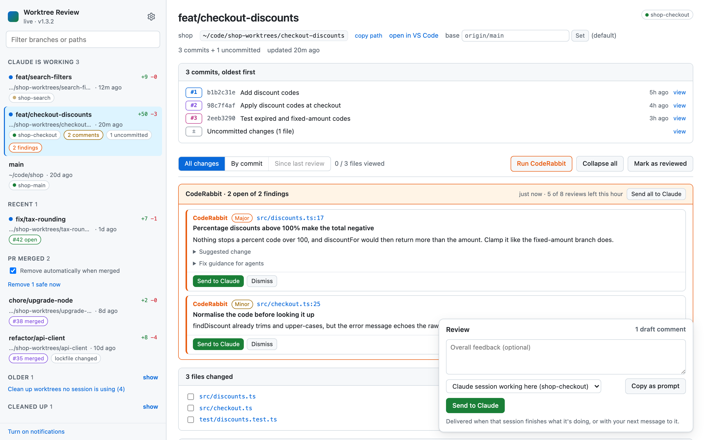
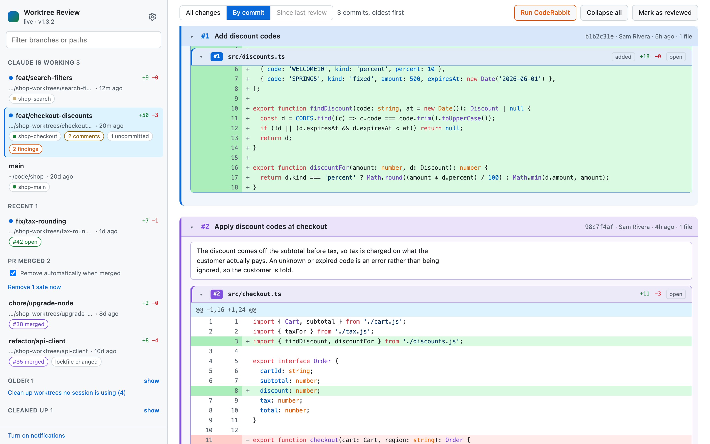
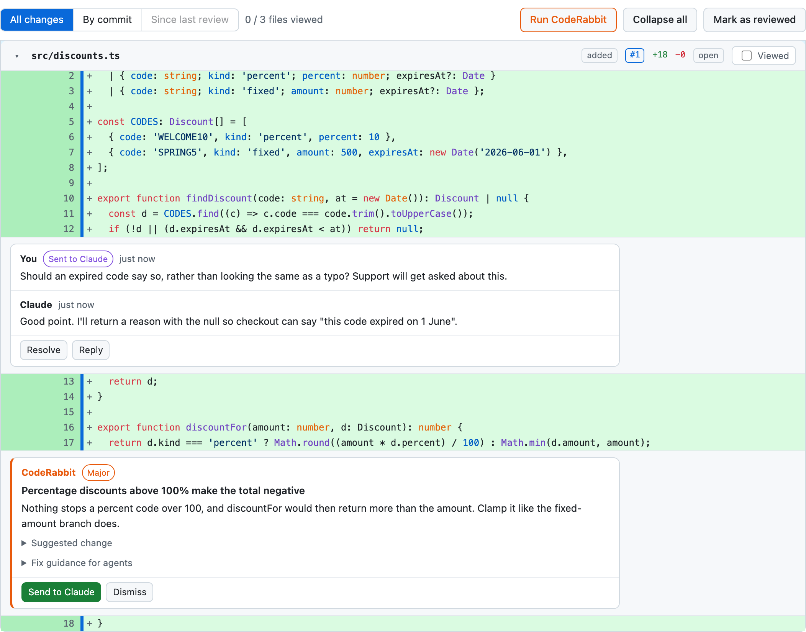
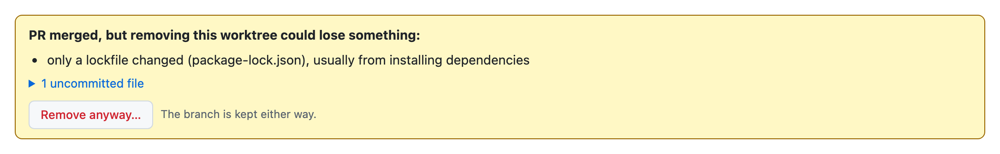
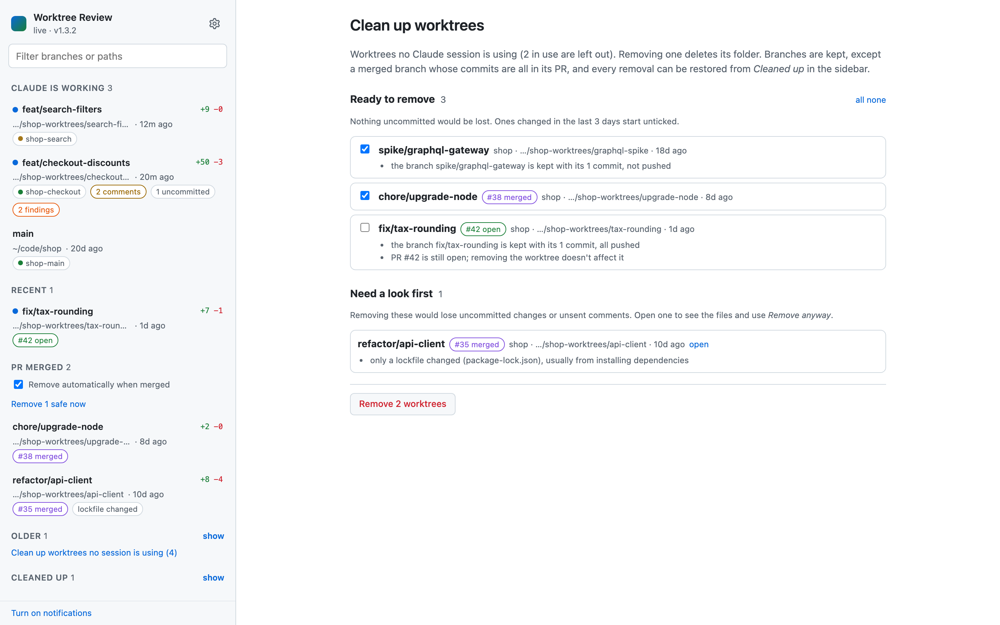
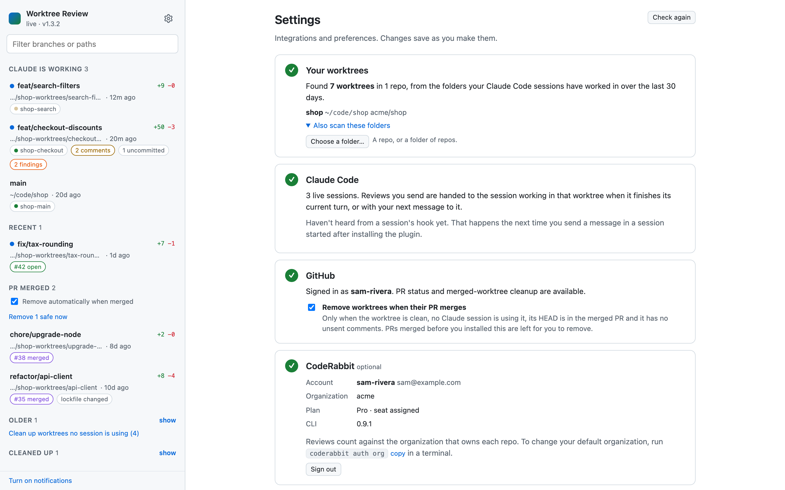

# Worktree Review

**Review what Claude Code is doing in your git worktrees, the way you'd review a pull request, before it becomes one.**

Worktree Review is a Claude Code plugin that runs a small dashboard on your machine at
http://localhost:4747. It finds every worktree your Claude Code sessions are working in, shows each
one's changes as a GitHub-style diff, and lets you leave line comments that go straight back to the
session doing the work. When a branch's PR merges, its worktree tidies itself away.



## Why

Running several Claude Code sessions in parallel worktrees is fast, but keeping up with them is not.
You end up asking each session "what did you change?", reading diffs in a terminal, and typing
feedback back in. Worktree Review gives you one screen to keep open: you see what's new, review it
properly, and your comments reach the right session without you switching to it.

## Features

### Every worktree in one place

The sidebar groups worktrees into **Claude is working** (a live session is using it), **Recent**,
**PR merged** and **Older**. A blue dot means it changed since you last reviewed it. Each one shows
its PR, uncommitted changes, open comments and CodeRabbit findings. Turn on notifications to hear
when a session finishes work you haven't looked at.

### Review it like a pull request

The diff covers the branch's commits plus anything uncommitted or untracked. It's taken against the
PR's base, the branch it's stacked on, or `origin/main`, and you can change the base. Mark a worktree
as reviewed and **Since last review** shows only what changed after that. Tick files off as viewed.

### See the order it happened in

Commits are numbered oldest first, each with its own colour. In **All changes**, files are ordered by
the commit that first touched them, and every added line has a bar in the colour of the commit that
introduced it. Click a commit to highlight its lines. **By commit** replays the branch one commit at
a time, with each commit's full message, and ends with the uncommitted changes.



### Comments go back to Claude

Click `+` on any line to comment. **Send to Claude** delivers the whole review to the session
working in that worktree, at the end of its current turn or with your next message to it. Claude
replies in the thread or resolves the comment with a note, and replying sends the thread back.
**Copy as prompt** is there if you'd rather paste it yourself.

### CodeRabbit, optional

With the [CodeRabbit CLI](https://docs.coderabbit.ai/cli/overview) signed in, **Run CodeRabbit**
reviews the worktree against the same base. Findings appear inline, next to your own comments.
**Send to Claude** turns a finding into one of your draft comments, and **Dismiss** hides it. If
your company has CodeRabbit on GitHub, reviews of its repos use the company plan.



### Merged worktrees clean themselves up

When a branch's PR merges, its worktree is removed, along with the branch if everything on it is in
the PR. This only happens when nothing can be lost: no uncommitted changes, no live session using
it, no unsent comments. Otherwise the worktree says exactly why it stayed, lists the files involved,
and offers **Remove anyway…** where that's a judgement call, such as a lockfile changed by
`npm install`. PRs merged before you installed the plugin wait for **Remove N safe now**.



### Clear out worktrees nothing is using

**Clean up worktrees no session is using**, at the bottom of the sidebar, lists every worktree
without a live Claude session, merged or not, sorted into *ready to remove*, *needs a look first*
and *can't be removed*. Tick the ones to go. Unmerged branches are always kept, so only the folder
goes. This is never automatic.



Removals run in the background with a progress card in the sidebar, and take a moment even for a
worktree with a large `node_modules`. Every removal has a restore command under **Cleaned up**.

### Settings in the app

The first visit walks you through setup. **Settings** (the gear in the sidebar) covers which folders
are scanned, with a folder picker, GitHub and CodeRabbit status, signing in to CodeRabbit,
auto-cleanup, which editor the *open* links use, and timings.



## Install

You need **Node 18+** on your `PATH`. For PR status and cleanup you also need the
[GitHub CLI](https://cli.github.com), signed in with `gh auth login`. Everything else works without it.

In Claude Code:

```
/plugin marketplace add llanicm/worktree-review
/plugin install worktree-review@worktree-review
```

Start a new session. The dashboard starts in the background; open it with `/worktree-review:open` or
go to http://localhost:4747.

To update, run `/plugin marketplace update worktree-review`, then `/plugin update worktree-review`.
The next session that starts replaces the running dashboard with the new version, and open tabs
reload themselves.

## How it works

**Finding worktrees.** There's nothing to configure. It reads the working directories of your Claude
Code sessions from the last 30 days (in `~/.claude/projects`), finds the git repo for each, and lists
all of that repo's worktrees. You can add other folders in Settings.

**Linking sessions.** A live session counts as working in a worktree when its shell has been inside
it, or its conversation keeps mentioning the path.

**Delivering reviews.** The plugin adds `UserPromptSubmit` and `Stop` hooks. When you send a review,
the next of those hooks to fire in the right session hands it to Claude, with the file, line and
commit of each comment, and how to reply or resolve it.

**Removing worktrees safely.**

- Removing a worktree only ever risks what isn't committed, so uncommitted files block it unless
  you choose **Remove anyway…**, which lists exactly what will be lost.
- Commits live on the branch. A branch is deleted only when its PR merged and every commit on it has
  a matching change in the PR. Commits are matched by content, so a rebased PR still counts.
- A detached HEAD whose commits aren't on any branch, a locked worktree, one a session is using, and
  one changed in the last 10 minutes are never removed.
- Worktrees whose links to their repository broke, usually because the repo moved, are flagged with
  a **Repair** button that runs `git worktree repair`.

## Configuration

Settings are saved to `~/.claude/worktree-review/config.json`. If you edit it by hand, restart the
dashboard: `curl -X POST -H 'x-wtr: 1' localhost:4747/api/shutdown`, then start a new session or run
`/worktree-review:open`.

| Key | Default | |
|---|---|---|
| `roots` | `[]` | Extra folders whose immediate children are scanned for repos |
| `extraRepos` | `[]` | Extra repos to always include |
| `autoCleanup` | `true` | Remove worktrees automatically when their PR merges |
| `recentDays` | `3` | How long a worktree counts as *Recent* |
| `prPollMinutes` | `5` | How often PR status is checked |
| `editor` | `"vscode"` | Target of the *open* links: `vscode`, `cursor`, `windsurf`, `zed` or `none` |

Set `WTR_PORT` in your environment to use a different port.

### Keep it running without Claude Code (macOS)

The plugin starts the dashboard whenever a session starts. To keep it running from login instead,
clone this repo and run `extras/install-service.sh`. `extras/uninstall-service.sh` removes it.

## Privacy and security

- Your code stays on your machine, apart from what CodeRabbit reviews when you run it. The network
  is used only by `gh`, `coderabbit`, a `git fetch` of a merged PR's commits when they aren't local,
  and the page loading highlight.js from cdnjs.
- The server listens on `127.0.0.1` only, rejects requests addressed to any host other than
  localhost, and requires an `x-wtr` header on anything that changes state, which other websites
  can't send.
- Comments, review marks and the cleanup log are kept in `~/.claude/worktree-review/state.json`; the
  log is in `server.log` next to it.

## Development

The server is a single Node file with no dependencies (`server/server.mjs`) that shells out to `git`,
`gh` and `coderabbit`. The page is plain HTML, CSS and JavaScript in `server/public/`.

| Path | |
|---|---|
| `server/server.mjs` | The server: worktree discovery, diffs, comments, PRs, cleanup, CodeRabbit |
| `server/public/` | The page. `sse-worker.js` shares one live connection across tabs, because browsers cap connections per host |
| `scripts/hook.mjs` | Hands submitted reviews to the right session (`UserPromptSubmit` and `Stop` hooks) |
| `scripts/ensure-server.mjs` | Starts or upgrades the server (`SessionStart` hook and `/worktree-review:open`) |
| `extras/demo/` | A self-contained demo and the README screenshots |

To try it without touching your own repos, run the demo. It builds a made-up repo with worktrees,
Claude sessions, PRs and a CodeRabbit review in `.demo/`, with its own home folder and stand-ins for
`gh` and `coderabbit`, and serves it on port 4848:

```sh
node extras/demo/demo.mjs
open http://localhost:4848
```

It prints the command to stop it when you're done.

To refresh the screenshots, run `node extras/demo/screenshots.mjs` while the demo is up. It needs
Google Chrome; set `CHROME` to its path if it isn't in the usual macOS place.

When you change the plugin, bump `version` in `.claude-plugin/plugin.json`, so running dashboards
are replaced on the next session start.

## License

[MIT](LICENSE)
